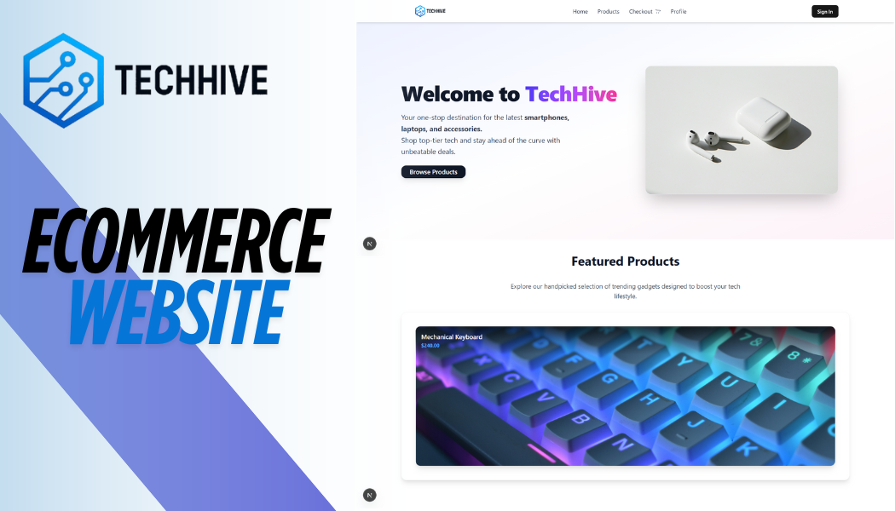

# TechHive

An electronics storefront with a built-in admin dashboard. Stripe is the product catalog and the payment processor, so products, prices and checkout all live in one place.



[Demo video](https://drive.google.com/file/d/1A7BO5w7OsahNwxu1cKB5SnsyGJ3ZaHjy/view?usp=drive_link)

## Features

**Storefront**

- Product catalog with listing and detail pages
- A cart managed in a persisted Zustand store
- Hosted Stripe Checkout with success and cancel redirects
- Sign-up, sign-in and profile management through Clerk

**Admin dashboard**

- Create, edit and delete products from `/admin`
- Changing a price creates a new Stripe price and makes it the default, so past orders keep their original price
- Product images are uploaded to Supabase Storage
- Access is limited to a single Clerk user ID, checked in middleware

## Tech stack

| Layer          | Technology                                      |
| -------------- | ----------------------------------------------- |
| Framework      | Next.js 15 (App Router, Server Actions), React 19, TypeScript |
| Styling        | Tailwind CSS 4, shadcn/ui, Radix UI             |
| State          | Zustand                                         |
| Authentication | Clerk                                           |
| Payments       | Stripe (Products, Prices, Checkout)             |
| File storage   | Supabase Storage                                |

## How it works

```
Admin form ──> Server Action ──> Stripe Products / Prices
                     │
                     └──> Supabase Storage (product images)

Storefront ──> Stripe Products API (catalog)
Cart ──> Server Action ──> Stripe Checkout Session ──> /success
```

Route protection lives in [`middleware.ts`](middleware.ts). Public routes are the home page, the product pages and the auth pages. Every other route requires a signed-in user, and `/admin` also requires that user to match `NEXT_PUBLIC_ADMIN_USER_ID`.

## Project structure

```
app/
  (pages)/        admin, checkout, products, profile, sign-in, sign-up, success
  actions/        Server Actions for Stripe and Supabase
components/
  component/      Product list, product form, admin list, carousel, navbar
  ui/             shadcn/ui primitives
lib/              Stripe and Supabase clients
store/            Zustand cart store
middleware.ts     Clerk authentication and admin guard
```

## Getting started

### Prerequisites

- Node.js 18 or later
- [Clerk](https://clerk.com), [Stripe](https://stripe.com) and [Supabase](https://supabase.com) accounts

### Setup

1. Install dependencies.

   ```bash
   npm install
   ```

2. In Supabase Storage, create a public bucket named `products`.

3. Copy `.env.example` to `.env.local` and fill in the values.

   ```bash
   cp .env.example .env.local
   ```

   | Variable                            | Description                                         |
   | ----------------------------------- | --------------------------------------------------- |
   | `NEXT_PUBLIC_CLERK_PUBLISHABLE_KEY` | Clerk publishable key                               |
   | `CLERK_SECRET_KEY`                  | Clerk secret key                                    |
   | `NEXT_PUBLIC_ADMIN_USER_ID`         | Clerk user ID of the person allowed into `/admin`   |
   | `STRIPE_SECRET_KEY`                 | Stripe secret key (use a test key for development)  |
   | `NEXT_PUBLIC_SUPABASE_URL`          | Supabase project URL                                |
   | `NEXT_PUBLIC_SUPABASE_ANON_KEY`     | Supabase anonymous public key                       |
   | `NEXT_PUBLIC_BASE_URL`              | Public URL of the app, used for Stripe redirects    |

4. Start the development server and open http://localhost:3000.

   ```bash
   npm run dev
   ```

### Scripts

| Command         | Description                   |
| --------------- | ----------------------------- |
| `npm run dev`   | Start the development server  |
| `npm run build` | Create a production build     |
| `npm start`     | Serve the production build    |
| `npm run lint`  | Run ESLint                    |

## License

Copyright (c) 2025 Erdi Latifi.

This project is source-available under the [PolyForm Noncommercial License 1.0.0](LICENSE). You may use, study and modify it for personal, educational and other noncommercial purposes. Commercial use is not permitted without written permission from the author.
